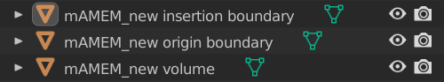
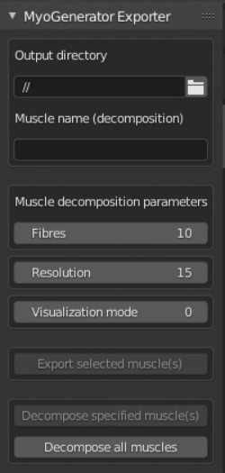
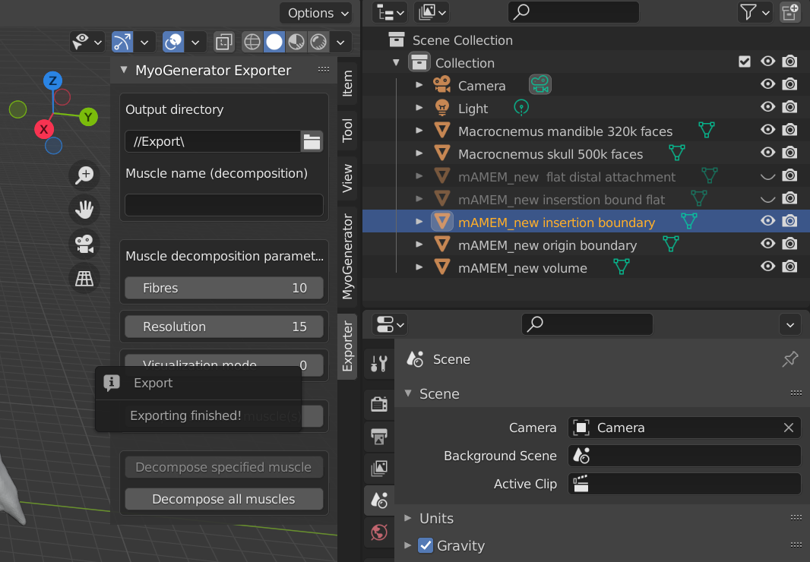
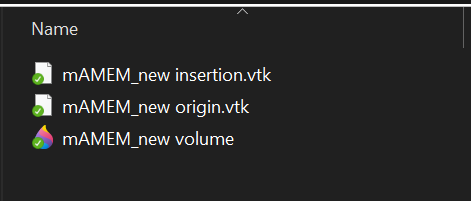
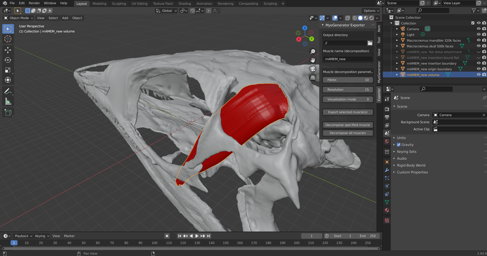
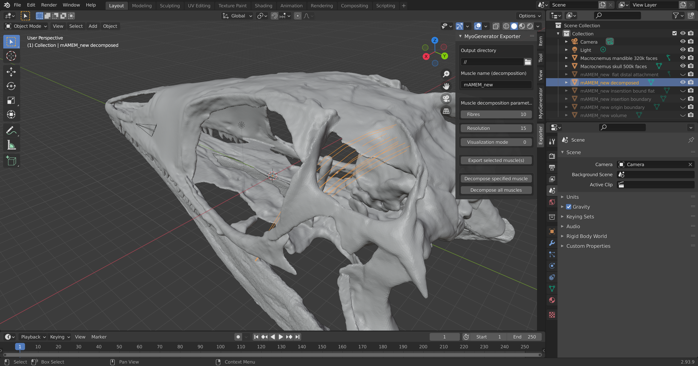
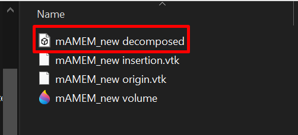

# Introduction
A Blender add-on for:
- Easy export of **models of muscles** with their *origin* and *insertion* areas from Blender
- Model decomposition into **a set of muscle fibres** = a more realistic representation

## A quick thank you
This add-on as basically a wrapper for an already existing muscle decompositor, which is a part of a bigger project called **Muscle Wrapping 2.0** (more info [here](https://doi.org/10.1007/s10439-020-02490-4) and [here](https://doi.org/10.1111/cgf.12354))

# Installation

**Prerequisite**: For STL exporting, install the [STL format](https://extensions.blender.org/add-ons/stl-format-legacy/?utm_source=blender-5.2.2-lts) addon

To install this add-on, download the intended [release](https://github.com/JayAitchh/blender-muscle-decompositor/releases) and proceed with [this guide](https://docs.blender.org/manual/en/latest/editors/preferences/addons.html).
After a successfull installation, the add-on should be present on the right vertical add-on toolbar (showed by pressing the **N** key).

# Usage 

## Model hierarchy
For the add-on to successfully decompose a muscle, the user has to create **3** separate models:
- Model of the muscle volume
- Model of the origin area
- Model of the insertion area

The name of the models in the scene **MUST** follow a naming convention: 
- For the volume model:`<muscle_name><space>volume`
- For the insertion area: `<muscle_name><space>insertion<space>boundary`
- For the origin area: `<muscle_name><space>origin<space>boundary`

A proper muscle model could have following hierarchy (in the scene):

 

*The name of the muscle model in this case is mAMEM_new*

## Overview

 
 

 

- **Output directory**
    - This parameter is used for selecting a work folder.
    - Export and decomposition functionalities are working **within this** directory
- **Muscle name (decomposition)**
    - This parameter serves **only** for the singular decomposition process
    - After pressing this button, the add-on searches for the [essential](#model-hierarchy) files in the [output directory](#output-directory)
- **Decomposition parameters**
    - For the decomposition process, following parameters can be set, which implicate the model's structure:
        - *Fibres*: Number of muscle fibres of which the muscle should consist of
        - *Resolution*: Number of segments of each fiber (each fiber is basically a segmented line)
        - *Visualization mode*: 
          - *None* - No visualization
          - *Visualize* - Standard visualization in a separate window
          - *Debug* - For development purposes
- *Optional parameters*
    - These parameters are not strictly required, though some of them are recommended
        - **Vertices reordering** - Reorder vertices into a sequential numbering order. It is strongly recommended for proper decomposition results.
        - **Mesh triangulation** - Convert quadrilateral volume meshes to a triangular one.

## How to export a model
The [3 separate models](#model-hierarchy) can be exported out of Blender.
To export them, select which of the model should be exported.
After that, click on the **Export selected muscle(s)** to export all the selected models (and their parts).
The number of models/parts to export is **not** limited.

If the export was successfull, the following pop-up should appear:

>*If a dialog with different a message appears, please proceed to the [Troubleshooting](#troubleshooting) section*

and a new file, in the [output directory](#output-directory), should appear (with the same name).

 

The export format is **VTK** for the insertion/origin areas, **STL** for the volume. 

## How to decompose a model
If you already have the models exported, you can start with the decomposition.
- **Single model**: To decompose only a **single** muscle, you **have to** specify the *muscle_name*. This is one of the reasons why the naming conventions must be followed.
- **Multiple models**: The [output directory](#output-directory) is searched through, extracting every unique muscle name and decomposing all muscles found.

If the process finished successfully, the decomposed result is imported automatically back into Blender. A new file is also created in the [output directory](#output-directory)

 
 

 

# Troubleshooting
> No muscles to decompose found in the specified directory
- [Output directory](#output-directory) is most likely empty. Make sure, you're in the right directory. If it is not empty, make sure you're following the [naming conventions](#model-hierarchy)
> MuscleDecomposition executable has not been found...
- One of the needed source tools is missing. Reinstall the add-on and try again
> Decomposition has been aborted due to the following reason
- Something went wrong during the decomposition process. Try to decompose a muscle with **visualization mode = 2**, screenshot the console output and open an issue in the [GitHub repository](https://github.com/JayAitchh/blender-muscle-decompositor).
